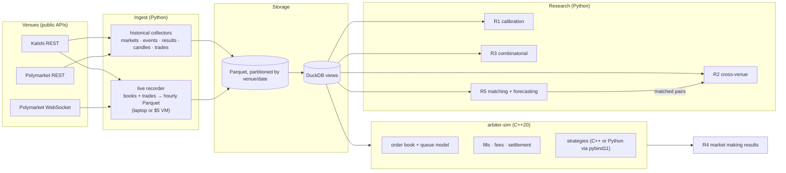

# Arbiter build plan

Arbiter is a pricing and trading research lab for prediction markets (Kalshi and Polymarket). The core question: **are prediction market prices right, and where they aren't, can the error be traded after fees?** It is research and paper trading only. No real orders are ever placed.

This is a planning document: the questions, data, architecture, schemas, milestones and how every claim gets measured. The checklist at the bottom tracks progress.

## Why this project (target roles: QR, QT, QD, MLE)

| Role | What the project demonstrates |
|---|---|
| Quant research | Calibration and longshot-bias study on thousands of resolved markets; mispricing statistics with clustered confidence intervals; walk-forward, out-of-sample discipline |
| Quant trading | Market making for binary contracts (inventory risk, a jump to 0/1 at resolution, adverse selection); edge measured after fees and spread; position sizing |
| Quant dev | Live data recorder for two venues; an event-driven C++20 backtester (order book, queue-position fills, fees) with Python bindings, unit tests and throughput benchmarks |
| MLE | Matching the same event across venues (text embeddings plus rules); a resolution-forecasting model judged by whether it beats the market price out of sample |

## Data sources (verified 2026-10-13, all public, no account)

| Venue | Endpoint | Gives |
|---|---|---|
| Kalshi | `GET /trade-api/v2/markets?status=settled` | resolved markets: `result`, open/close/settlement times, full rules text, last price, volume |
| Kalshi | `GET /events?with_nested_markets=true` | multi-outcome events (e.g. `KXFED-26OCT`: 11 rate outcomes) |
| Kalshi | `GET /series/{s}/markets/{t}/candlesticks?period_interval=1` | **historical 1-minute bars of yes bid/ask/trade price**, volume, open interest |
| Kalshi | `GET /markets/{t}/orderbook` | full depth, both sides |
| Kalshi | `GET /markets/trades` | trade prints (taker side, size, price) |
| Polymarket | `gamma-api /markets`, `/events` | markets back to 2020, questions, outcomes, CLOB token ids |
| Polymarket | `clob /prices-history?market=<token>` | historical price series |
| Polymarket | `clob /book?token_id=` | full depth |
| Polymarket | `data-api /trades` | trade prints |
| Polymarket | `wss://ws-subscriptions-clob.polymarket.com/ws/market` | live book and trade stream |

Historical order-book depth isn't available from either venue, which is why the recorder exists. Kalshi's 1-minute historical bid/ask candles allow top-of-book backtests from day one; the recorder adds depth and queue position going forward.

## Research questions and how each is measured

### R1. Calibration and the favorite–longshot bias
- **Data:** every resolved binary market with enough volume, sampled at fixed horizons before close (1 week, 1 day, 1 hour). Use the bid/ask midpoint at that time, never the settlement price.
- **Measures:** reliability diagram, Brier score and log loss. A logistic regression of the outcome on logit(price) gives a slope below 1, which means longshots are overpriced. Measured by category, liquidity tier and horizon, with bootstrap confidence intervals clustered by event, because markets within one event aren't independent.
- **Trading test:** buy favorites or sell longshots at the actual ask or bid plus fees. Walk forward in time, parameters fit only on the past, report P&L and t-stat.

### R2. Cross-venue mispricing
- **Data:** the same real-world event listed on both Kalshi and Polymarket (matched in R5), with prices aligned in time.
- **Measures:** the *executable* gap, not the midpoint gap. A gap is an opportunity only if (yes ask on A) + (no ask on B) + fees < $1. Report how often, how large, how long it lasts, and how much size is available at those prices.
- **Caveat:** resolution rules can differ between venues ("by 11:59 ET" vs "by end of day"), so every matched pair records whether the resolution criteria are actually identical.

### R3. Combinatorial consistency
- **Mutually exclusive outcome sets** (e.g. "which rate after the Fed meeting"): the sum of yes asks should be ≥ $1, and the sum of yes bids should be ≤ $1. Measure violations net of fees.
- **Strike ladders** ("above X", "above X+0.25"): prices must not increase as the strike goes up. Measure monotonicity violations.
- **Combo / parlay markets** (Kalshi multivariate markets): compare each combo's price with what its legs imply, assuming independence and with simple correlation adjustments. Measure the implied house edge on combos versus the legs. This is the most novel piece.

### R4. Market making binary contracts
- **Strategy:** an Avellaneda–Stoikov-style quoter adapted to contracts bounded between $0 and $1. It quotes in logit space, where the price can't leave its bounds, skews quotes against inventory, widens as resolution approaches (jump risk), and stops quoting before scheduled news. Fees are included.
- **Backtest:** the C++ simulator replays history: first Kalshi 1-minute top-of-book candles, then recorded full-depth books and trades. Fills use queue position: an order fills only after the size ahead of it at its price has traded.
- **Measures:** P&L, P&L per contract, inventory over time, markouts (adverse selection: price move after each fill), Sharpe across markets and days, all walk-forward. A paper-trading mode runs the same strategy against live books with simulated fills.

### R5. ML
- **Cross-venue matching:** embed market titles and rules, then add rule-based checks (dates, thresholds, named entities). Precision and recall are measured against a hand-labeled set of pairs.
- **Resolution forecasting:** features from the market itself (price path, spread, volume, time to close, category). The model succeeds only if its Brier score beats the market price out of sample, with a time-based split. "The market is hard to beat" is an acceptable, reportable result.

## Architecture



## Data model (Parquet, queried through DuckDB)

```text
markets          venue, market_id, event_id, title, subtitle, category, market_type,
                 open_time, close_time, settle_time, result (yes/no/void), rules_text,
                 strike (nullable), volume, open_interest
events           venue, event_id, title, category, mutually_exclusive (bool), n_markets
candles          venue, market_id, ts (minute), yes_bid, yes_ask, last, volume, open_interest
trades           venue, market_id, ts, price, size, taker_side          (no wallet addresses)
book_snapshots   venue, market_id, ts, seq, side (yes/no), level, price, size
book_deltas      venue, market_id, ts, seq, side, price, size_after     (WebSocket venues)
matches          kalshi_market_id, polymarket_market_id, score, method,
                 same_resolution (bool), label (hand-checked: true/false/null)
fees             venue, effective_from, formula, maker/taker details
```

Prices are stored as dollars in [0, 1], times are UTC, and sizes are in contracts.

## C++ simulator design (arbiter-sim)

- **Event loop:** a merged, time-ordered stream of book updates, trades and timers from Parquet (read via Arrow).
- **Book:** price levels on a fixed $0.001 grid, at most 1000 levels per side, stored in a flat array, so updates cost O(1) and allocate no memory.
- **Fills:** each resting order tracks the volume queued ahead of it at its price level. That volume shrinks with trades at the level and with cancels (assumed to come proportionally from ahead and behind). A crossing order fills immediately at the touch, up to the size available there.
- **Accounting:** position, cash, fees (each venue's fee formula), mark-to-market, and settlement to $0 or $1 at resolution.
- **Interfaces:** a `Strategy` interface in C++ with a pybind11 trampoline, so strategies can be written in Python and the fast ones moved to C++.
- **Quality bar:** GoogleTest for the book, the queue model, fees and settlement; Google Benchmark for event throughput (events/sec); CMake builds; CI on Linux.

## Milestones

- [ ] **M0 Setup:** repo, Python env (`uv`), C++ toolchain check in WSL (g++-12, CMake, gtest, benchmark, pybind11), CI for both. Confirm each venue's fee schedule and rate limits from its docs.
- [ ] **M1 Data:** historical collectors to Parquet/DuckDB, with resumable pagination and rate limiting. Start the live recorder as early as possible, since its value grows with time running. Data-quality report (coverage, gaps).
- [ ] **M2 R1 calibration study**, written up with plots.
- [ ] **M3 R5 matching + R2 cross-venue mispricing.**
- [ ] **M4 R3 combinatorial consistency** (exclusive sets, ladders, combos).
- [ ] **M5 arbiter-sim core in C++:** book, queue fills, fees, settlement, pybind11, tests, benchmarks.
- [ ] **M6 R4 market making:** strategy, walk-forward backtests on 1-minute history and then on recorded depth, plus a paper-trading mode.
- [ ] **M7 R5 forecasting model** vs market price.
- [ ] **M8 Ship:** RESULTS.md (measured numbers only), README (Mermaid diagram, quickstart, results, design decisions), INTERVIEW_NOTES.md, PR merged.

## Rules and risks

| Topic | Handling |
|---|---|
| No trading | Research and paper trading only; no API keys are needed and none are used |
| Polymarket in the US | Restricted for US persons; used only as a public data source |
| Rate limits / terms | Public endpoints only, client-side rate limiting with backoff, cached results, no scraping of authenticated pages |
| Privacy | Polymarket trade prints include wallet addresses; they are dropped at ingest |
| Recorder uptime | Gaps are logged, and the backtest only uses intervals with continuous coverage. The recorder runs on the laptop by default; a small VM is optional. |
| Look-ahead bias | Prices are sampled strictly before close; settlement prices are never used as features; time-based splits; fees and spreads always applied |
| Overlapping markets | Confidence intervals are clustered by event, since markets within one event are correlated |
| Thin markets | Liquidity filters (volume, spread) are reported with every result, and capacity is estimated from book depth |
| "No edge" | A valid finding, and it gets reported. The value is a rigorous answer, not a made-up Sharpe ratio. |
