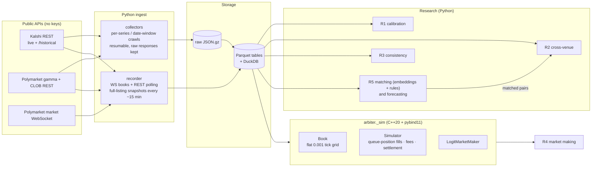

# Arbiter

Arbiter is a research lab for prediction markets (Kalshi and Polymarket). It asks one question: **are the prices right, and where they aren't, can the error be traded after fees?** It collects every resolved market both venues expose, records live order books, and measures five things:

1. **Calibration (R1).** Do 90¢ contracts win 90% of the time, or are long shots overpriced?
2. **Cross-venue mispricing (R2).** Gaps between Kalshi and Polymarket prices for the same event, counted only when they are executable after fees.
3. **Internal consistency (R3).** Strike ladders, mutually exclusive outcome sets and combo (parlay) prices, with every violation classified as risk-free or not.
4. **Market making (R4).** A logit-space Avellaneda–Stoikov quoter, backtested in a C++20 event-driven simulator with queue-position fills.
5. **Forecasting (R5b).** Can a model beat the market's own price, out of sample?

It is research and paper trading only. No orders are ever placed. Results: [RESULTS.md](RESULTS.md).

## Architecture



| Path | Role |
|---|---|
| `arbiter/venues/` | Kalshi and Polymarket clients and normalizers |
| `arbiter/collect.py` | historical crawls (series, markets, candles, price history, trades) |
| `arbiter/recorder.py` | live depth, trades and full-listing top-of-book capture |
| `arbiter/fees.py`, `cpp/include/arbiter/fees.hpp` | fee models read from venue metadata (Python and C++, tested for agreement) |
| `arbiter/research/` | calibration, matching, consistency, forecasting |
| `arbiter/backtest.py` | events from candles/recordings into the simulator; walk-forward evaluation |
| `cpp/` | order book, simulator, market maker, GoogleTest, Google Benchmark, pybind11 bindings |
| `labels/` | 300 hand-labeled cross-venue pairs; manual rules reviews of every R2/R3 candidate |
| `results/` | the measured reports behind RESULTS.md |

## Quickstart

Linux or WSL with g++ ≥ 12 and CMake; Python ≥ 3.10.

```bash
pip install -e ".[dev]"                     # builds the C++ extension
pip install -e ".[dev,match]"               # also the embedding model for cross-venue matching (PyTorch, CPU is fine)
pytest -q                                   # Python tests (C++ bindings included)
cmake -S . -B build && cmake --build build -j && ctest --test-dir build   # C++ tests
./build/arbiter_bench                       # simulator throughput

python -m arbiter.collect kalshi-series     # then kalshi-markets, polymarket-markets, tables, ...
python -m arbiter.recorder                  # leave running; writes data/recorder/
python -m arbiter.research.calibration      # and crossvenue, consistency, marketmaking, forecast (RESULTS.md)
```

## Benchmarks and results

Measured on the data described in [RESULTS.md](RESULTS.md): 1.58M markets collected, 127K with price history, and one evening (7.7 h) of live recording. Short version: prices are close to right, and no apparent edge survived fees, spreads and a reading of the rules.

| Question | Result |
|---|---|
| R1: are Kalshi prices calibrated? | Yes. 1-day slope **1.01** (95% CI 0.99–1.03), 40,552 snapshots / 13,889 events. Buying favorites loses **0.77¢ per contract** after fees (t = −8.2) |
| R1: Polymarket? | Prices look too extreme (slope 0.75), concentrated in pre-game sports. Not claimed as tradable: the price history has no bid or ask, and noisy prices bias the slope the same way |
| R2: cross-venue gaps | Biggest net gap **60¢ → 1.9¢** after reading both venues' rules: 11 of 29 positive pairs were different questions and 8 had different resolution rules |
| R3: consistency violations | 0 profitable ladder violations. 548 of 553 cheap outcome sets were missing outcomes. The real violations had 1–10 contracts of depth |
| R4: market making (Polymarket depth, 5.1 h, 31 markets) | **−0.82¢ per contract** at realistic queue position, matching the −0.78¢ 5-minute markout (adverse selection); still −0.38¢ at the front of the queue |
| R5: model vs market price | Brier skill **+0.47%** (CI excludes 0), 58,155 markets out of sample: real but far below a spread |
| Matching | 0.95 precision / 0.49 recall (5-fold CV, 300 hand labels) |
| Simulator | **21.2M events/s** replay with the market maker attached; **1.58 ns** per book update |

## Design decisions & tradeoffs

- **Executable gaps, never midpoint gaps.** A cross-venue or consistency "arbitrage" counts only if you could buy both legs at the quoted asks and still clear both venues' taker fees. Midpoint gaps are reported for context, but most of them vanish once you pay the spread.
- **Every apparent arbitrage is read by a human before it is reported.** The matcher is 95% precise, but the pairs with the biggest gaps are exactly the ones most likely to be wrong: two different propositions naturally have different prices. All 29 positive pairs were checked against both venues' rules ([labels/r2_review.csv](labels/r2_review.csv)). Eleven were different questions, and eight had different resolution rules: Kalshi's Coachella "headliner" requires actually performing, while Polymarket resolves on the poster announcement.
- **Fees come from venue metadata, in one model shared by Python and C++.** Kalshi charges `ceil(0.07·C·P(1−P))` with per-series multipliers and maker fees on some series, and Polymarket sets a per-market `feeSchedule`. Both are coded once per language and tested against each other, so research numbers and simulator P&L can't drift apart.
- **Clustered statistics.** Markets in one event (11 Fed-rate outcomes, 30 strikes of one ladder) are not independent samples. Every CI is event-clustered (GLM cluster-robust SEs, clustered bootstrap), which widens intervals honestly instead of reporting 500K "independent" markets.
- **Prices are sampled before close.** R1 reads the midpoint 1 hour, 1 day or 1 week before close, requires a two-sided book with a spread of at most 10¢ and a quote no staler than 6 hours, and never uses settlement or last-trade prices. Strategy thresholds are chosen walk-forward, on earlier months only.
- **A flat-array book in C++.** Prices sit on a fixed 0.001 grid, at most 1001 levels per side, so a book update is an array write with no allocation (~1.6 ns). The simulator tracks each resting order's queue position (volume ahead at its level, reduced by trades and by a proportional share of cancels), which is what makes passive-fill P&L believable. Python drives it through pybind11, with a trampoline so strategies can be prototyped in Python.
- **Market making in logit space.** Binary contracts are bounded by 0 and 1, and their volatility collapses near the bounds. Quoting Avellaneda–Stoikov in log-odds keeps quotes inside (0, 1), makes spreads naturally tighten near 0 and 1, and skews against inventory. The quoter widens into resolution and stops before close, because the price jumps to 0 or 1 at settlement.
- **Snapshot data can't prove passive fills, so the backtester doesn't pretend.** Candle and listing data only show the top of the book, so a quote resting at the touch never fills in replay. The simulator reports zero rather than inventing fills; R4's passive results use recorded depth plus trade prints only.
- **The collectors are built to survive.** The crawls make 100K+ requests over hours on a laptop, so every raw response is saved atomically and every job is resumable. Network outages retry for up to 30 minutes, a market that fails is skipped instead of killing the run, and the WebSocket reconnects after 60 s of silence. One DNS outage during the build proved this was needed.
- **Venue quirks are handled explicitly.** Polymarket's gamma API silently caps pages at 100 and rejects offsets past ~2000, so markets are crawled in end-date windows that split when dense, deduplicated across window edges. Before that fix, edge duplicates produced 78 fake neg-risk arbitrages. Kalshi events reuse one event id for different quantities, so ladders are keyed on the ticker minus its strike; before that fix there were 4,933 fake ladder violations.
- **Deadlines, not close times.** Both venues move a market's close time with its outcome (a "by date X" market closes early when X happens). Sampling prices before the actual close leaks the outcome (a synthetic test shows a 20-point inflation of the win rate), so every horizon is measured from the scheduled deadline, and a market is used only if it was still open at that time.
- **"No edge" is a result.** Where fees and spreads remove the edge, the result is reported as zero.
