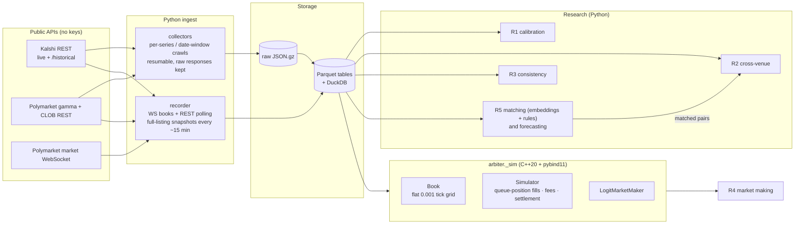

# Arbiter

Arbiter is a research lab for prediction markets (Kalshi and Polymarket). It asks one question: **are the prices right, and where they aren't, can the error be traded after fees?** It collects every resolved market both venues expose, records live order books, and measures five things:

1. **Calibration (R1).** Do 90¢ contracts win 90% of the time, or are long shots overpriced?
2. **Cross-venue mispricing (R2).** Gaps between Kalshi and Polymarket prices for the same event, counted only when they are executable after fees.
3. **Internal consistency (R3).** Strike ladders, mutually exclusive outcome sets and combo (parlay) prices, with every violation classified as risk-free or not.
4. **Market making (R4).** A logit-space Avellaneda–Stoikov quoter, backtested in a C++20 event-driven simulator with queue-position fills.
5. **Forecasting (R5b).** Can a model beat the market's own price, out of sample?

It is research and paper trading only. No orders are ever placed. Results: [RESULTS.md](RESULTS.md).

## Architecture



| Path | Role |
|---|---|
| `arbiter/venues/` | Kalshi and Polymarket clients and normalizers |
| `arbiter/collect.py` | historical crawls (series, markets, candles, price history, trades) |
| `arbiter/recorder.py` | live depth, trades and full-listing top-of-book capture |
| `arbiter/fees.py`, `cpp/include/arbiter/fees.hpp` | fee models read from venue metadata (Python and C++, tested for agreement) |
| `arbiter/research/` | calibration, matching, consistency, forecasting |
| `arbiter/backtest.py` | events from candles/recordings into the simulator; walk-forward evaluation |
| `cpp/` | order book, simulator, market maker, GoogleTest, Google Benchmark, pybind11 bindings |
| `labels/match_labels.csv` | 300 hand-labeled cross-venue pairs |

## Quickstart

Linux or WSL with g++ ≥ 12 and CMake; Python ≥ 3.10.

```bash
pip install -e ".[dev]"                     # builds the C++ extension
pytest -q                                   # Python tests (C++ bindings included)
cmake -S . -B build && cmake --build build -j && ctest --test-dir build   # C++ tests
./build/arbiter_bench                       # simulator throughput

python -m arbiter.collect kalshi-series     # then kalshi-markets, polymarket-markets, tables, ...
python -m arbiter.recorder                  # leave running; writes data/recorder/
python -m arbiter.research.calibration      # and consistency, forecast; see RESULTS.md for commands
```

## Benchmarks and results

__RESULTS_TABLE__

## Design decisions & tradeoffs

__DESIGN__
