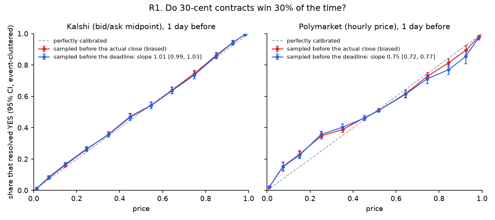
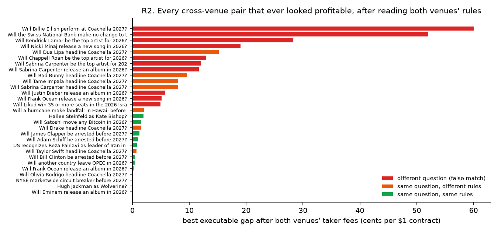
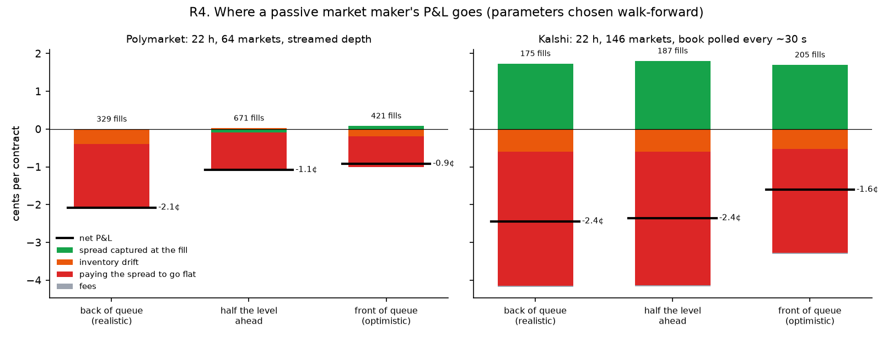

# Results

Every number below was measured by the code in this repo on the data described here. The raw reports are in [`results/`](results/), copied from `data/reports/`. Commands to reproduce each one are at the end.

**Short version:**
- Prices on both venues are close to right, and every apparent edge either disappeared once spreads and fees were paid or could only be traded in single contracts.
- A passive market maker captures no spread on Polymarket at a realistic queue position, and on Kalshi captures 1.7¢ per contract but pays more than that to get flat.
- Most of the work was finding apparent edges that were data artifacts. Each one is listed in [Artifacts caught](#artifacts-caught) with how it was found.

## Data

| | Kalshi | Polymarket |
|---|---|---|
| Markets collected | 525,190 (up to 300 per series, across 14,993 series) | 1,051,527 (closed, ≥ $1,000 volume, since 2020) |
| Resolved YES/NO | 519,256 | 1,046,373 |
| Markets with price history | 66,438 (hourly bid/ask candles, last 7 days before close; ≥1,000 volume, ≤15 per series) | 60,719 (hourly price, last 7 days; ≥$50K volume, ≤2 per event) |
| Price rows | 8,967,777 total | |
| Live recording | Full listing of every open market (~135K) every ~15 min; REST book polls for 40 watched markets at a time (432 in total) | Full listing (~36K markets), 29–31 snapshots; WebSocket depth + trades for 150 tokens |
| Recording window | 2026-10-13 21:35 → 2026-10-14 19:17 UTC (21.7 h of listings; 22.2 h of book data) | same; 49,003 WebSocket trades on the R4 markets |

The recording is short (about a day), so the cross-venue, consistency and market-making results are based on hours, not weeks. They describe that window only. Kalshi's full listing takes minutes to page through, and under rate limits some passes stop early; only passes logged complete are analysed (R2 used 12, R3 13).

## R1. Calibration

**Method:**
- Price = midpoint 1 hour, 1 day or 1 week before each market's *scheduled* deadline, and only if the market was still open then.
- Kalshi quotes must be two-sided with a spread of at most 10¢ and be no more than 6 hours old. Polymarket uses its hourly history price.
- Logistic GLM of the outcome on logit(price), with event-clustered SEs. A slope above 1 is the favorite–longshot bias; below 1 means prices are too extreme.

| Venue / horizon | Snapshots | Events | Slope (95% CI) | Brier | Brier skill vs base rate |
|---|---|---|---|---|---|
| Kalshi 1 h | 48,999 | 17,399 | 1.061 (1.038–1.084) | 0.078 | 0.658 |
| Kalshi 1 d | 40,552 | 13,889 | **1.009 (0.986–1.033)** | 0.108 | 0.522 |
| Kalshi 1 w | 3,206 | 983 | 1.126 (1.017–1.235) | 0.081 | 0.602 |
| Polymarket 1 h | 48,480 | 46,044 | 0.786 (0.759–0.813) | 0.212 | 0.148 |
| Polymarket 1 d | 22,917 | 20,525 | **0.747 (0.718–0.775)** | 0.202 | 0.180 |
| Polymarket 1 w | 7,545 | 7,452 | 0.841 (0.779–0.903) | 0.220 | 0.120 |



**Kalshi is calibrated at 1 day.** In the reliability table, 7¢ contracts won 8.4% (95% CI 7.3–9.4%), 25¢ won 26.5%, 75¢ won 73.6% and 93¢ won 94.2%. There's a mild favorite–longshot pattern 1 hour and 1 week out. By category at 1 day, slopes run from 0.95 (Sports, n = 16,532) to 1.16 (Politics) and 1.38 (Science and Technology, n = 856).

**Buying favorites doesn't pay on Kalshi.** The strategy buys whichever side is above a threshold, at the ask, plus taker fees, holds to resolution, and picks the threshold walk-forward by month.

| Horizon | Trades | Events | Win rate | Mean cost | P&L per contract | Event-clustered t |
|---|---|---|---|---|---|---|
| 1 h | 30,456 | 10,163 | 98.8% | 99.2¢ | −0.51¢ | −7.5 |
| 1 d | 17,639 | 6,597 | 98.5% | 99.3¢ | −0.77¢ | −8.2 |
| 1 w | 2,484 | 878 | 95.2% | 95.1¢ | −0.16¢ | −0.3 |

**Polymarket prices look too extreme (slope ≈ 0.75), but this is not claimed as a tradable bias.** At 1 day, 7¢ contracts won 15.1% (12.3–18.0%) and 92¢ contracts won 85.4% (80.8–89.7%). The pattern holds in every volume tier: low 0.71, mid 0.76, high 0.78. Splitting by how far the actual close lands from the scheduled end puts most of the effect in markets resolving 0.05–1 day after `endDate`, which on Polymarket is mostly sports, where `endDate` is the scheduled start. Two reasons for caution:
- Polymarket's history has hourly prices with no bid or ask, so I can't filter stale quotes or thin books the way the Kalshi sample is filtered.
- Random error in the price variable biases the slope toward 0 even when the true price is calibrated.

Telling a real bias apart from noisy prices needs historical quotes, which Polymarket doesn't publish. The recorder is collecting them going forward.

**Sampling before the actual close leaks the outcome** (proven on synthetic data; see [Artifacts caught](#artifacts-caught), item 1), but on this data the 1-day difference is small. For comparison, with horizons measured from the actual close: Kalshi 1 d slope 1.027, Kalshi 1 h 1.083, Polymarket 1 h 1.033. See [Artifacts caught](#artifacts-caught), item 1.

## R2. Cross-venue mispricing

**Method:**
- Pairs come from the matcher: p ≥ 0.7, which gives 0.95 precision and 0.49 recall in 5-fold cross-validation on 300 hand-labeled pairs.
- In every complete snapshot pair (Kalshi and Polymarket within 30 minutes), the executable gap is the bid on one venue minus the ask on the other, net of both taker fees. Polymarket fees are charged at the highest published rate (0.07).
- **Every pair that was ever net-positive was checked by hand against both venues' rules** ([`labels/r2_review.csv`](labels/r2_review.csv)).

| | All matched pairs | After the rules review |
|---|---|---|
| Pairs quoted on both venues | 117 | 97 |
| Pair-snapshots | 1,384 | 1,144 |
| Median \|mid gap\| | 3.0¢ | 2.25¢ |
| 90th percentile \|mid gap\| | 24.0¢ | 14.0¢ |
| Share of snapshots net-positive after fees | 19.2% | 7.3% |
| Pairs ever net-positive | 29 | 9 |
| **Largest net gap** | **60.0¢** | **1.9¢** |

What the review found among the 29 pairs that were ever positive:
- **11 false matches:** album vs song, tour vs album, headliner vs performer, "above 29 seats" vs "35 or more".
- **9 pairs with different resolution rules.** In the Coachella headliner pairs, Kalshi pays only if the artist actually performs as a headliner, through Dec 31, 2027; Polymarket resolves on the lineup announcement. The Hawaii hurricane pair compares a season with a calendar year. For Eminem, Kalshi counts an EP of new material while Polymarket needs an album with at least 50% new tracks.
- **9 equivalent pairs** (both rulebooks read), worth at most 1.9¢ net. The median positive pair stayed positive in all 12 snapshots, so these are small, stable price differences, not fleeting ones.



The largest gaps are where the matcher's errors are: two different questions naturally have different prices. That's a selection effect a precision number alone doesn't show.

## R3. Internal consistency

Bids, asks and fees come from the same listing snapshot, and every candidate violation was read by hand ([`labels/r3_review.csv`](labels/r3_review.csv)).

| Check | Scope | Apparent violations | After verification |
|---|---|---|---|
| Strike ladders (Kalshi): P(above X) must not rise with X | 13 snapshots | 107 violations in 18 events, median 1¢ gross | **0** profitable after fees |
| Sell every outcome when the bids sum above $1 (Kalshi mutually-exclusive events) | 5,378 events | 1 | Redistricting count: +0.12¢ net, thinnest bid 3 contracts |
| Sell every outcome (Polymarket neg-risk groups) | 3,043 groups | 3 groups (38 snapshots) | NHL most hat tricks: up to +6.5¢, thinnest bid **1 contract**. Ravens–Bengals: a cancelled season resolves all three outcomes 50-50, which turns the trade into a loss. VALORANT most kills: exclusive and exhaustive (ties broken by ACS, then deaths), +1.2¢, depth not measured |
| Buy every outcome when the asks sum below $1 (Polymarket) | 591 candidate groups | **586 missing outcomes** from the listing | 5 complete sets, all read: Maduro sentencing 3.4¢ net, fee-free, but 10 contracts deep and ~15 months to resolution (≈2%/yr, below T-bills); Anthropic IPO valuation 2.6¢ for up to 15 months (≈2%/yr); El Niño peak 1.6¢ until ~March 2027 (≈4%/yr); Resident Evil gross 0.6¢; Bitcoin/Gold/S&P 0.8¢ in one snapshot |
| Buy every outcome (Kalshi) | 1,120 candidate group-snapshots | Kalshi's "mutually exclusive" events are open fields (next Pope, primaries, House races listing only R and D) | none riskless |
| Combos vs the product of their legs (Kalshi) | 7 combo quotes | median ask 3.7% (1.1¢) above the independence price, none below | too few to conclude; combos are priced on request |

## R4. Market making



**Method:**
- **Polymarket:** the WebSocket capture (full-depth book snapshots and deltas, plus every trade) for the 64 YES tokens with at least 50 trades.
- **Kalshi:** the recorder's REST book polls (each watched market about every 30 s) plus that market's public trade prints, for the 146 markets with at least 20 trades. Each series is charged its own fees, including maker fees on the 23 series that have them.
- **Replay:** everything goes through the C++ simulator. Resting orders fill only when trades work through the queue ahead of them.
- **Blocks:** the 22.2 h recording is cut into 6 blocks. Each block starts flat and closes any inventory at the touch.
- **Parameters:** for block *i*, chosen from a 12-point grid (risk aversion, k, minimum spread) by P&L on blocks < *i*.
- **P&L split** (an exact identity, tested), per contract:
  - *spread captured* (fill price vs the mid just before the fill);
  - *inventory drift* (how the mid moved afterwards, until the block ended);
  - *close-out* (paying the spread and a taker fee to go flat at block end);
  - fees.

Trade prints agree with the reconstructed books. On Polymarket, 83% of taker buys printed at or above the prevailing ask (6% at or below the bid). On Kalshi it's 78% (12%), as expected when the book is only seen every 30 s.

Per contract, back of queue (the default) and the two sensitivity runs:

| | Fills | Contracts | Net P&L | Spread captured | Inventory drift | Close-out | Fees | 5-min markout | t (per block, n=5) |
|---|---|---|---|---|---|---|---|---|---|
| **Polymarket**, back of queue | 329 | 2,569 | **−2.08¢** (−$53.34) | **0.00¢** | −0.39¢ | −1.68¢ | 0.00¢ | −0.35¢ | −1.7 |
| half the level ahead | 671 | 5,464 | −1.08¢ | −0.09¢ | +0.02¢ | −1.02¢ | 0.00¢ | −0.29¢ | −1.7 |
| front of queue | 421 | 3,175 | −0.92¢ | +0.08¢ | −0.19¢ | −0.81¢ | 0.00¢ | −0.14¢ | −1.4 |
| **Kalshi**, back of queue | 175 | 1,043 | **−2.44¢** (−$25.45) | **+1.73¢** | −0.60¢ | −3.54¢ | 0.03¢ | +1.26¢ | −1.1 |
| half the level ahead | 187 | 1,086 | −2.36¢ | +1.81¢ | −0.60¢ | −3.53¢ | 0.03¢ | +1.38¢ | −1.1 |
| front of queue | 205 | 1,193 | −1.60¢ | +1.70¢ | −0.53¢ | −2.75¢ | 0.03¢ | +1.37¢ | −1.0 |

**What this says:**
- **Polymarket:** at a realistic queue position the quoter captures no spread at all. By the time the queue ahead of it has traded through, the price has come to its quote, so it fills at the mid. That is adverse selection at the moment of the fill, which is why the 5-minute markout afterwards is small.
- **Kalshi:** spreads are wide, so the quoter does capture 1.7¢ per contract. But the wide spread is also what it pays to go flat (−3.5¢), and inventory drifts against it (−0.6¢).
- **Where the loss comes from:** on both venues, most of the measured loss is the forced close-out at the end of each ~3.7 h block. A desk would work out of inventory passively, so the close-out overstates the cost. Without it (spread + drift − fees), the quoter makes −0.39¢ on Polymarket and +1.1¢ on Kalshi per contract.
- **The Kalshi number has a known bias:** a quoter that sees the book only every 30 s quotes stale prices that a live quoter wouldn't. So Kalshi spread capture is measured on worse information than a real market maker would have.
- **Not significant per block:** with 5 traded blocks, the per-block t-statistics (−1.0 to −1.7) aren't significant. The decomposition, not the total, is the result.

An earlier 5.1 h subset (31 Polymarket markets) showed a −0.82¢ per contract loss roughly equal to the 5-minute markout. With 4× the data, the loss is dominated by spread not captured plus the close-out instead. Results this short are sensitive to the window.

## Paper trading

`python -m arbiter.papertrade --markets 20 --minutes 1440` runs the same quoter, with fixed parameters from R4's grid (point 7: γ = 0.5, k = 20, minimum spread 2 ticks; the 5.1 h walk-forward's most frequent pick), against live Polymarket WebSocket books. Each message is fed to a C++ simulator per market as it arrives; nothing is sent to any venue. It logs position, cash and P&L at the touch every minute, and writes fills, a P&L series and a summary to `data/papertrade/<run>/`. A 24-hour run on the 20 most-traded markets is in progress. A 5-minute smoke run processed 2,214 live events with quotes resting in all 8 markets and no fills, consistent with R4's Polymarket rate of about one fill per 4 market-hours.

## R5. Matching and forecasting

**Matching:** with a logistic model on 12 features and 300 hand labels, 5-fold CV precision is 0.95 and recall 0.49 at p ≥ 0.7. 128 pairs were matched among the open markets.

**Forecasting:**
- Features at 1 day before the deadline: price (logit), moves over 6 h, 1 d and 3 d, spread, market age, category, venue, and price × category and price × venue interactions.
- Time-ordered folds: train on earlier markets, score later ones. 58,155 markets scored in 28,493 events.

| Forecast | Brier | Log loss | Brier − market (event-clustered 95% CI) | Brier skill vs market |
|---|---|---|---|---|
| Market price | 0.14931 | 0.4415 | | |
| Logistic | 0.14870 | 0.4398 | −0.00061 (−0.00096, −0.00025) | +0.41% |
| Gradient boosting | 0.14860 | 0.4388 | −0.00070 (−0.00112, −0.00028) | +0.47% |

By venue (gradient boosting vs price): Kalshi 0.12513 vs 0.12546, Polymarket 0.20736 vs 0.20900. The model beats the price by a statistically clear but economically tiny margin, mostly by recalibrating, for example shrinking Polymarket's too-extreme prices. A 0.0007 Brier gain is nowhere near a 1–2¢ spread plus fees.

## Simulator performance

Release build (`-O3`), Intel Core Ultra 9 185H under WSL2, Google Benchmark, median of 5 repetitions ([`results/bench.txt`](results/bench.txt)):

| Benchmark | Result |
|---|---|
| Replay 1M events with `LogitMarketMaker` attached (quotes, cancels, fills) | 47.3 ms → **21.2M events/s** |
| One book level update (`Book::set`) | **1.58 ns** |

An earlier run, while the data crawls were using the CPU, measured 16.1M events/s and 2.04 ns.

## Artifacts caught

Each of these produced a striking "result" before it was found:

1. **Outcome-dependent close times (R1, R5).** Both venues close "by date X" markets early when X happens. So "1 day before the actual close" samples YES markets just before the surprise and NO markets at the dead end: the close time carries the outcome. A synthetic test with perfectly calibrated by-date markets shows this sampling inflating the win rate by 20 points. The fix measures horizons from the scheduled deadline and requires the market to be open. On the real data, the effect at 1 day turned out small (Kalshi slope 1.03 naive vs 1.01 fixed), and it does **not** explain Polymarket's too-extreme prices, which remain with the fix. That's why that pattern is reported with a caveat instead of being dismissed as this artifact.
2. **Pager duplicates (R3).** Polymarket's gamma API caps pages at 100 and rejects offsets past ~2,000. The date-window crawler duplicated markets on window edges, which created 78 fake neg-risk arbitrages.
3. **Kalshi events aren't ladders (R3).** One event can hold different quantities (rain in several cities). Grouping strikes by event produced 4,933 fake ladder violations; keying on ticker minus strike left 16 events.
4. **Incomplete outcome sets (R3).** 548 of 553 sub-$1 Polymarket outcome sets were missing outcomes from the listing.
5. **False matches carry the biggest gaps (R2).** All of the 60¢ and 7–25¢ cross-venue gaps were different questions or different rules.
6. **Timestamp units.** pandas 3 reads microsecond timestamps; day differences computed as if they were nanoseconds were 1000× too small, which hid that most true cross-venue matches close more than 3 days apart.
7. **Partial listing snapshots.** Under rate limits a Kalshi listing pass sometimes finished early (52K of 135K markets). Snapshots now carry a completeness flag, and only complete ones are analysed (14 of 34 by the end of the window).
8. **An undeclared dependency.** A fresh clone following the README couldn't run the matcher: `sentence-transformers` was installed locally but not declared. It's now the `match` extra. Found by testing the published repo from scratch.

## Reproduce

```bash
python -m arbiter.collect kalshi-series && python -m arbiter.collect kalshi-markets --per-series 300 --workers 6
python -m arbiter.collect polymarket-markets --min-volume 1000
python -m arbiter.collect kalshi-candles --min-volume 1000 --per-series 15 --horizon-days 7 --workers 6
python -m arbiter.collect polymarket-prices --workers 8 --min-volume 50000 --per-event 2 --max-markets 60000
python -m arbiter.collect tables
python -m arbiter.recorder --kalshi 40 --polymarket 150 --kalshi-rps 1.5     # leave running
python -m arbiter.research.calibration
python -m arbiter.research.crossvenue
python -m arbiter.research.consistency --verify
python -m arbiter.research.marketmaking
python -m arbiter.research.forecast
python -m arbiter.plots                     # charts in docs/img from results/
python -m arbiter.papertrade --markets 20 --minutes 1440
./build/arbiter_bench --benchmark_repetitions=5 --benchmark_report_aggregates_only=true
```
